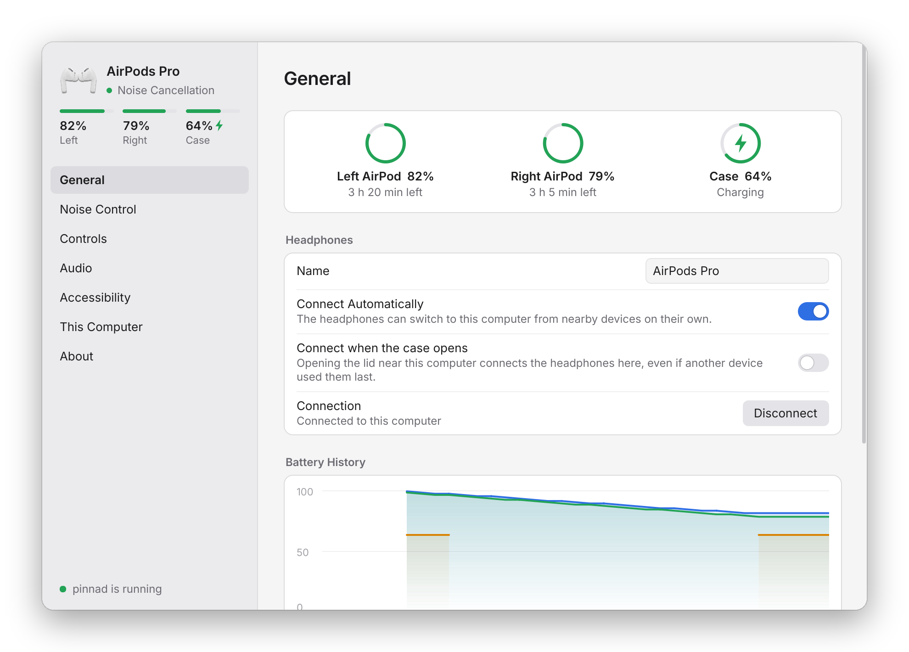
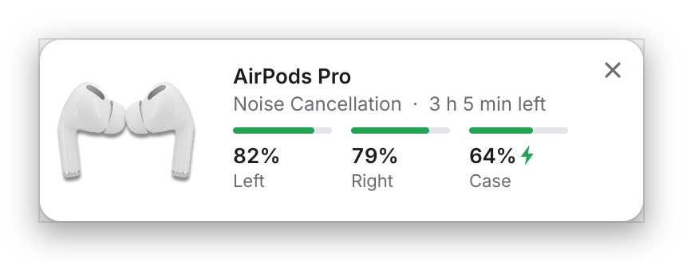
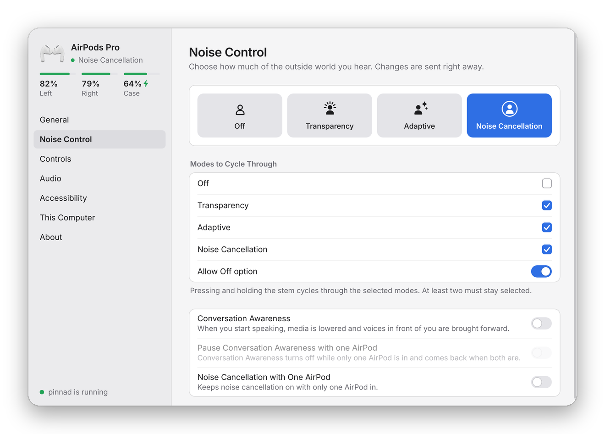
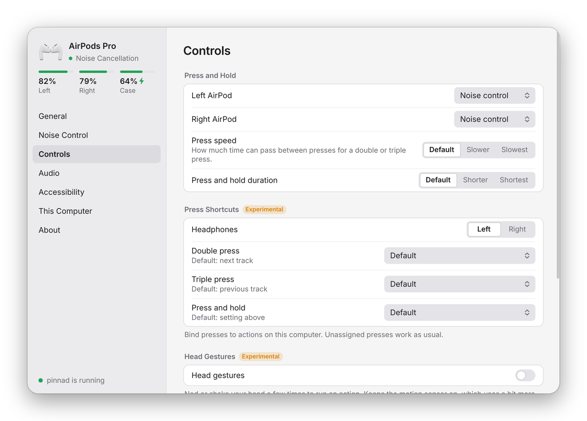
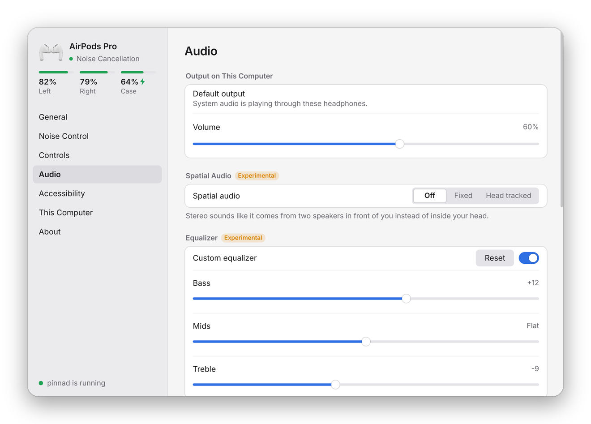
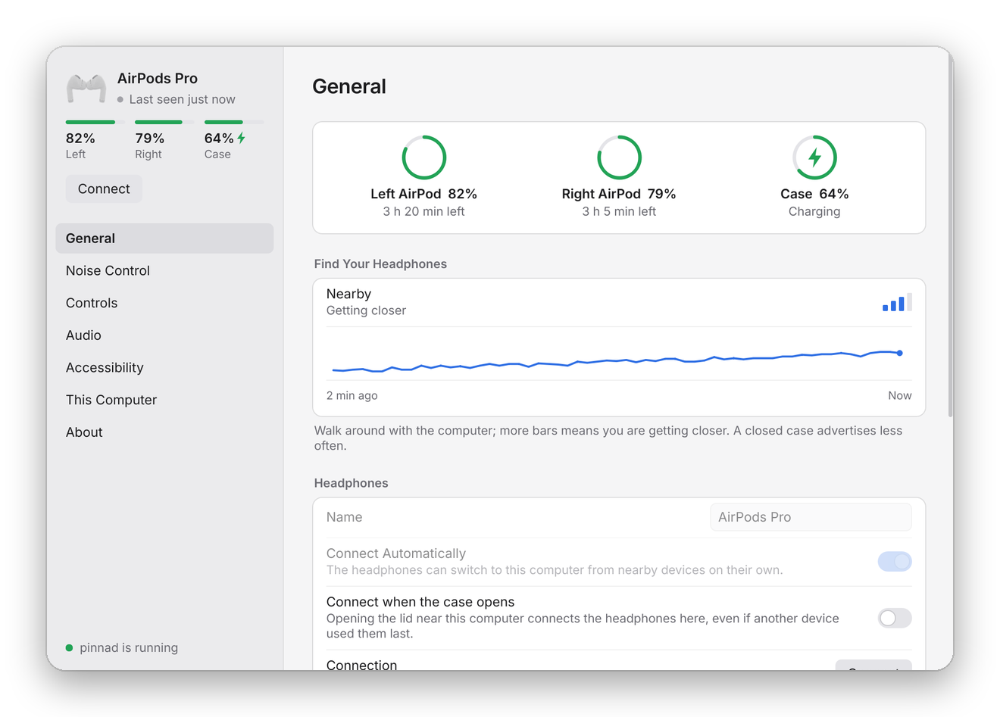
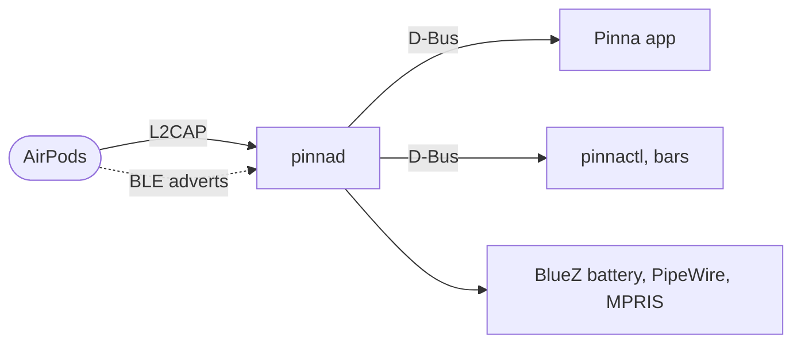

<p align="center">
  
</p>

<h1 align="center">Pinna</h1>

<p align="center">
  AirPods on the Linux desktop. Battery, noise control, every setting, in a native app.
</p>

<p align="center">
  <a href="https://github.com/saiv0n/pinna/actions/workflows/rust.yml"></a>
  <a href="LICENSE"></a>
  
  
  
</p>

<p align="center">
  <a href="#install">Install</a> ·
  <a href="#features">Features</a> ·
  <a href="#supported-headphones">Supported headphones</a> ·
  <a href="#command-line">Command line</a> ·
  <a href="#troubleshooting">Troubleshooting</a> ·
  <a href="ROADMAP.md">Roadmap</a>
</p>

<br>

<p align="center">
  <a href="https://github.com/saiv0n/pinna/releases/download/v0.1.0/pinna-demo.mp4">
    
  </a>
</p>

<br>

On a phone, AirPods show their battery the moment you open the case, switch noise modes with a tap and keep a long list of settings. On Linux they are a plain Bluetooth headset. Pinna speaks the same protocol the phone does, so the buds behave on your computer the way they do on an iPhone, and it fits in with the rest of the desktop: tray, notifications, the system battery indicator, your bar and your shortcuts.

<picture>
  <source media="(prefers-color-scheme: dark)" srcset="docs/img/general-dark.png">
  
</picture>

It is a small service that talks to the headphones and an app on top of it. Nothing leaves your computer: the service has no network access and keeps its keys in a file only you can read.

## Features

### Battery

Left, right and case, with the time left for each bud estimated from how fast it has been draining and a chart of the last 24 hours. While the case is closed you still see its last known level, and while the buds are away Pinna says when it last saw them. You get a notification when a bud or the case runs low, with how long is left, and one when charging is done.

When you open the case near the computer, a small card shows up in the corner, the way it does on a phone. Click it to open the app.

<p align="center">
  <picture>
    <source media="(prefers-color-scheme: dark)" srcset="docs/img/card-dark.png">
    
  </picture>
</p>

### Noise control

Noise cancellation, transparency, adaptive and off switch instantly. In adaptive mode you set how much of the outside comes through. You choose which modes pressing and holding the stem cycles through, and each bud can flip between its own two modes.

Conversation awareness, personalized volume, noise cancellation with one AirPod, volume swipe, press speed and hold duration, case speaker volume, sleep detection and hearing assistance are all there. Conversation awareness can pause itself while only one bud is in.

<picture>
  <source media="(prefers-color-scheme: dark)" srcset="docs/img/noise-dark.png">
  
</picture>

### Controls

A double, triple or long press on either bud can do something on the computer instead: mute the mic, change the volume or the track, switch modes or run a command of yours. Presses you leave alone keep doing what the buds normally do. The buds forget these settings whenever they pair with another device, so Pinna writes them again on every connection.

Take a bud out and whatever is playing pauses; put it back and it resumes. This works with any player that supports MPRIS. While you talk, the computer's volume drops.

<picture>
  <source media="(prefers-color-scheme: dark)" srcset="docs/img/controls-dark.png">
  
</picture>

### Sound

The buds become the default output when they connect, or only once you put one in, whichever you prefer. Music stays in AAC unless you pick another codec.

Calls are the weak spot of Bluetooth on Linux: the moment an app opens the mic, sound drops to phone quality. Pinna gives you a choice. You can use the computer's mic and keep music quality, or use the AirPods mic in high quality: it arrives over a separate channel, Pinna decodes it into an input called "(Pinna)" and opens it only while an app is listening. Discord, browsers and anything else see it as a normal microphone.

<picture>
  <source media="(prefers-color-scheme: dark)" srcset="docs/img/audio-dark.png">
  
</picture>

### Finding them

When the buds are not connected but nearby, Pinna shows their signal and the last two minutes of it, and tells you whether you are getting closer. There is no map: the only location source on most Linux desktops sends nearby Wi-Fi networks to an online service, and Pinna keeps everything on the computer. Playing a sound on the buds goes through Apple's Find My, which is not reachable from Linux.

<picture>
  <source media="(prefers-color-scheme: dark)" srcset="docs/img/find-dark.png">
  
</picture>

### On the desktop

The tray icon carries a small ring for the lower bud, and its menu has the battery, the modes, connect and disconnect. Closing the window keeps Pinna in the tray, and it can start there when you log in.

Battery levels are reported to BlueZ, so GNOME, KDE, UPower and most bars show them in their own indicators. There are ready modules for [Waybar](#waybar) and [Caelestia](#caelestia), global shortcuts through the desktop portal on KDE and GNOME, and `pinnactl` for everything else.

With more than one pair of AirPods or Beats, each keeps its own keys and settings. You can switch between them from the app or the tray, pair new ones and forget old ones.

The app follows the system theme and language. It comes in English and Turkish, and a new language is a single file.

### Experimental

These work on my AirPods Pro 2 but depend on things I could only check on one pair, so they are off until you turn them on.

| Feature | What it does |
| --- | --- |
| Spatial audio | Stereo sounds like two speakers in front of you, with the PipeWire HRTF filter. In head tracked mode the sound stays put when you turn. Needs `libmysofa`. |
| Head gestures | Nod or shake to play, pause, skip or run a command. |
| Custom EQ | Bass, mids and treble, stored in the headphones. Shown only when the model reports it. |
| Loud sound reduction | Shown only on models that report it. |
| Head tracking view | The angles follow your head live. |

Not there yet: headphone accommodation, custom transparency, choosing which bud's mic to use, turning off ear detection, and the live noise level an Apple Watch shows. The buds never report these back, or nobody has found them in the protocol, so I could not make sure they work.

## Supported headphones

Every model below is recognized by name and gets the controls it reports. Settings a model does not have are hidden.

| Model | Status |
| --- | --- |
| AirPods Pro 2 (Lightning and USB-C) | Tested on hardware |
| AirPods Pro 3 | Checked against recorded packets |
| AirPods Max (Lightning and USB-C) | Checked against recorded packets |
| AirPods 4, AirPods 4 (ANC) | Checked against a simulated profile |
| AirPods (2nd generation) | Checked against a simulated profile |
| AirPods Pro, AirPods (3rd generation) | Should work, untested |
| Beats Studio Buds, Studio Buds +, Fit Pro, Solo Buds, Solo 4, Studio Pro, Powerbeats Pro 2 and older Beats | Should work, untested |

If you own one of the untested models, a bug report with the exported log (see [Troubleshooting](#troubleshooting)) helps more than anything else.

## Install

Pair the headphones once from your system Bluetooth settings. Pinna finds them after that.

### Arch Linux

```bash
git clone https://github.com/saiv0n/pinna.git
cd pinna/dist/arch
makepkg -si
systemctl --user enable --now pinnad.service
```

### From source

```bash
git clone https://github.com/saiv0n/pinna.git
cd pinna
./install.sh
```

Everything goes under `~/.local` and the `pinnad` service is enabled with `systemctl --user`. No root needed. To remove it, delete the installed files and run `systemctl --user disable --now pinnad`.

You need:

| | |
| --- | --- |
| Rust 1.88 or newer | the service and `pinnactl` |
| Qt 6.8 or newer | Base, Declarative, Svg; Tools for translations |
| CMake and Ninja | building the app |
| BlueZ and D-Bus | talking to the headphones |
| PipeWire and WirePlumber | sound, with `wpctl` and `pactl` |
| FFmpeg (libavcodec) | the high quality AirPods mic |
| libmysofa | optional, for spatial audio |

### Flatpak

A manifest on the KDE 6.11 runtime lives in `dist/flatpak/`. It is not on Flathub yet.

```bash
flatpak-builder --user --install build dist/flatpak/dev.pinna.Pinna.yml
```

Inside the Flatpak the app starts the service itself, and `pinnactl` runs with `flatpak run --command=pinnactl dev.pinna.Pinna`.

### Optional: look like an Apple device

A few features only turn on when the headphones think they are talking to an Apple device. The DeviceID switch on the This Computer page adds one line to `/etc/bluetooth/main.conf` and restarts Bluetooth, after showing you the command and asking for your password. By hand:

```ini
DeviceID = bluetooth:004C:0000:0000
```

## Command line

```bash
pinnactl                          # status
pinnactl mode adaptive            # off, anc, transparency, adaptive
pinnactl cycle                    # next mode, same order as the stem
pinnactl card                     # show the battery card
pinnactl set conversationAwareness on
pinnactl watch                    # one JSON line per change
pinnactl doctor                   # check the setup
```

Bash, zsh and fish completions are installed with it.

### Shortcuts

On KDE, GNOME and other desktops with the global shortcuts portal, turn on Global shortcuts on the This Computer page and pick the keys in your desktop's settings. There is one for the next mode, one for each mode and one that shows the battery card.

On Hyprland:

```ini
bind = SUPER, A, exec, pinnactl cycle
```

<details>
<summary>Hyprland window rules</summary>

```lua
hl.window_rule({ name = "pinna", match = { class = "^(dev.pinna.Pinna)$" }, float = true, center = true, size = "900 620" })
hl.window_rule({ name = "pinna-card", match = { class = "^(dev.pinna.Popup)$" }, float = true, pin = true, move = "(monitor_w-window_w-16) 16", no_initial_focus = true })
```

</details>

### Waybar

`pinnactl waybar` prints a line whenever something changes: the lower bud in the bar, every battery and the mode in the tooltip, and the classes `connected`, `disconnected`, `low`, `charging` and the mode name for styling.

```json
"custom/airpods": {
    "exec": "pinnactl waybar",
    "return-type": "json",
    "restart-interval": 5,
    "format": "󰋋 {}",
    "on-click": "pinnactl cycle",
    "on-click-right": "pinna"
}
```

### Caelestia

`shell/caelestia/PinnaStatus.qml` puts a headphone icon, the lowest battery and the mode in the bar. Left click changes the mode, right click opens the app. Copy it to `modules/bar/components/status/` and add a `DelegateChoice` for it in `StatusIcons.qml`.

## Troubleshooting

Start with `pinnactl doctor`. It checks the service, BlueZ, the adapter, the paired headphones, the PipeWire tools and the tray, and tells you what to do about anything missing.

<details>
<summary>Connected, but no sound</summary>

Pinna asks BlueZ for the music profile once on its own. If it stays silent, check that "Use for system sound" on the Audio page is not set to Never, or disconnect and connect again from the General page.

</details>

<details>
<summary>Sound comes from only one bud</summary>

If both buds show as in the ear and `speaker-test -c2 -t wav` is heard on one side only, the buds lost their link to each other. Pinna cannot see that over Bluetooth. Put the silent bud in the case for a few seconds and take it out again.

</details>

<details>
<summary>The case card or the case battery never shows up</summary>

Connect the headphones once so they hand over their keys, and keep "Show battery when case opens" on.

</details>

<details>
<summary>A Bluetooth mouse or keyboard is slow to reconnect</summary>

That can come from scanning for the case. The scan already rests most of the time; turning "Show battery when case opens" off stops it.

</details>

<details>
<summary>The stem pauses but never plays again</summary>

BlueZ sends that press as a plain Pause key. Bind `XF86AudioPause` to `playerctl play-pause` in your desktop, or let Pinna handle that press under Controls, Press Shortcuts.

</details>

For a bug report, use Export on the This Computer page and attach the file. It starts with the doctor output and leaves out serial numbers, names and the device part of Bluetooth addresses.

## Privacy and security

The service runs sandboxed under systemd. It can write only to `~/.config/pinna`, `~/.local/state/pinna`, its runtime folder and one WirePlumber config folder for the call setting, and it has no network access. The keys the headphones hand over are stored with 0600 permissions and never show up in logs. The D-Bus interface checks every value it receives.

## How it works



| Part | What it is |
| --- | --- |
| `crates/core` | The protocol: packets, advert decryption, the settings table. No OS code, so a Windows or Android version can reuse it. |
| `crates/linux` | `pinnad`, the service that talks to BlueZ and PipeWire and publishes its state on D-Bus as `dev.pinna.Daemon`, and `pinnactl`. |
| `app` | The Qt Quick interface and the tray. |

### Developing without headphones

A second daemon with pretend headphones can run next to the real one:

```bash
PINNA_FAKE=1 PINNA_BUS=dev.pinna.Test XDG_CONFIG_HOME=/tmp/pinna-test XDG_STATE_HOME=/tmp/pinna-test target/release/pinnad
PINNA_BUS=dev.pinna.Test app/build/pinna
```

`PINNA_FAKE=pro3`, `max`, `airpods4` or `airpods2` pretends to be that model. The packets come from captures shared in LibrePods and CAPod, with names and serials removed, and the parser tests use the same ones.

`scripts/e2e.sh` runs the pretend headphones on a private bus with a pretend media player and checks mode changes per model, pausing when a bud comes out and settings surviving a reconnect. `scripts/check.sh` runs the tests and renders every page in both themes and languages; any QML warning fails it.

For screenshots, `PINNA_STATE=app/fixtures/connected.json PINNA_SHOT=out.png` loads a fixed state and saves the window.

### Translations

Each language is one file, `app/i18n/pinna_<code>.ts`, covering the app, the tray and the service's notifications. Run `app/i18n/update.py de` (or any language code), translate it in Qt Linguist or a text editor and rebuild. The language shows up on the This Computer page by itself.

### Headphone renders

The images are rendered in Blender from Jed Falcone's [AirPods Pro](https://sketchfab.com/3d-models/3f84ddc3d87a4ec0a5e5f379abfecd9c) model, licensed [CC BY 4.0](https://creativecommons.org/licenses/by/4.0/). The model is not in the repo; download it and run `art/build.sh path/to/Airpods_ForSketchfab.fbx`.

## Roadmap

Linux comes first, then Windows and Android. Both start with what the platform allows without a driver or root, battery and in-ear status from the BLE adverts, and grow from there. `crates/core` and the Qt app are shared, so most of the work carries over. The full plan is in [ROADMAP.md](ROADMAP.md).

## Contributing

Reports from headphones other than AirPods Pro 2 help the most, and there is an issue template just for that. For code and translations, [CONTRIBUTING.md](CONTRIBUTING.md) covers building, working without headphones and the checks to run. Security problems go through [SECURITY.md](SECURITY.md), not public issues.

## Thanks

To the [LibrePods](https://github.com/kavishdevar/librepods) team, whose protocol work made this possible, and to everyone who posted packet captures in their issues and in [CAPod](https://github.com/d4rken-org/capod).

## License

Pinna is made by [saivon](https://github.com/saiv0n) and released under the [GPL-3.0](LICENSE). You can use, change and share it freely. If you ship it or anything built on it, keep the line "Based on Pinna by saivon" with a link back here, in your documentation and on your About screen. The exact terms are in [NOTICE](NOTICE).

AirPods and Beats are trademarks of Apple Inc. Pinna is not affiliated with or endorsed by Apple.
