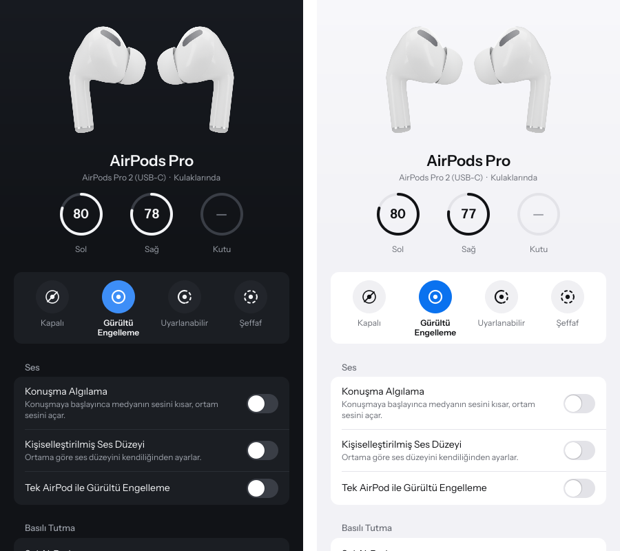

# Earshot

Linux için AirPods yöneticisi. Kulaklığı bağlar, pilini ve kulakta olup olmadığını gösterir, iPhone'daki ayarların neredeyse hepsini buradan değiştirmeni sağlar.



## Neler yapıyor

- Sol, sağ ve kutu pilini yüzde olarak gösteriyor, şarj olanı ayırıyor.
- Gürültü engelleme, şeffaf, uyarlanabilir ve kapalı modları arasında geçiyor. Uyarlanabilir modda ne kadar ortam sesi gireceğini 0 ile 100 arasında ayarlayabiliyorsun.
- Konuşma algılama, kişiselleştirilmiş ses düzeyi, tek kulaklıkla gürültü engelleme, ses kaydırma, basma hızı, basılı tutma süresi, kutu hoparlörünün sesi, uyku algılama.
- Sapı basılı tutunca hangi modlar arasında geçileceğini ve sol ile sağ kulaklığın ne yapacağını seçebiliyorsun. Kulaklık bunları her yeni cihazda unuttuğu için Earshot her bağlantıda yeniden yazıyor.
- Kulaklığın adını değiştirebiliyorsun.
- Bir kulaklığı çıkarınca çalan şey duruyor, takınca devam ediyor (MPRIS destekleyen her oynatıcıda).
- Konuşmaya başlayınca bilgisayarın sesini de kısıyor.
- Kutuyu açınca ya da kulaklık bağlanınca iPhone'daki gibi küçük bir kart çıkıyor.
- Pil azalınca bildirim gönderiyor.

Şu an AirPods Pro 2 (USB-C) üzerinde denendi. Diğer AirPods ve Beats modelleri de aynı protokolü konuştuğu için çoğu ayar çalışmalı, ama kulaklık bir özelliği desteklemiyorsa o ayar bir şey yapmaz.

## Kurulum

Gerekenler: Rust (1.85 ya da yenisi), Qt 6.8 ya da yenisi (Quick, QuickControls2, QuickEffects, DBus, Svg), CMake, Ninja, BlueZ, PipeWire (`wpctl`).

```bash
./install.sh
```

Betik her şeyi `~/.local` altına kurar, `earshotd` servisini `systemctl --user` ile açar. sudo istemez.

Kulaklığı önce sistemin Bluetooth ayarlarından bir kez eşleştirmen yeterli. Sonrasında Earshot kendisi bulur.

Bazı özellikler kulaklığın karşısında bir Apple cihazı olduğunu görmek istiyor. Bunun için `/etc/bluetooth/main.conf` dosyasına şu satırı ekleyip Bluetooth'u yeniden başlatabilirsin:

```
DeviceID = bluetooth:004C:0000:0000
```

## Komut satırı

```bash
earshotctl                     # durum
earshotctl mode adaptive       # off, anc, transparency, adaptive
earshotctl cycle               # modlar arasında sırayla geç
earshotctl set conversationAwareness on
earshotctl watch               # her değişiklikte bir satır JSON
```

`earshotctl cycle` Hyprland'de bir kısayola bağlamak için uygun:

```
bind = SUPER, A, exec, earshotctl cycle
```

## Caelestia barı

`shell/caelestia/EarshotStatus.qml` barda kulaklık simgesini, en düşük pili ve modu gösterir. Sol tık modu değiştirir, sağ tık uygulamayı açar. Dosyayı `modules/bar/components/status/` altına koyup `StatusIcons.qml` içine bir `DelegateChoice` eklemen yeterli.

## Nasıl çalışıyor

Apple kulaklıklarının ayarları AAP denen kapalı bir protokolle, Bluetooth üzerinde L2CAP 0x1001 kanalından gidiyor. Bu protokolü [LibrePods](https://github.com/kavishdevar/librepods) ekibi çözüp belgeledi, Earshot da o notlara dayanıyor.

Proje üç parça:

- `crates/core` protokolün kendisi: paketler, BLE reklamlarının çözümü, ayar tablosu. İşletim sisteminden bağımsız, ileride Windows ve Android sürümleri de bunu kullanacak.
- `crates/linux` BlueZ ile konuşan `earshotd` servisi ve `earshotctl`. Servis durumu D-Bus üzerinden `dev.earshot.Daemon` adıyla yayınlıyor.
- `app` Qt Quick ile yazılmış arayüz.

Kulaklık görselleri Blender'da render ediliyor. Model Jed Falcone'un [AirPods Pro](https://sketchfab.com/3d-models/3f84ddc3d87a4ec0a5e5f379abfecd9c) çalışması, [CC BY 4.0](https://creativecommons.org/licenses/by/4.0/) lisanslı. Modelin kendisi repoda yok; Sketchfab'den indirip görselleri şöyle yeniden üretebilirsin:

```bash
art/build.sh ~/Downloads/airpods-pro/source/Airpods_ForSketchfab.fbx
```

Işık, malzeme ve kadraj `art/render.py` içinde. Modeldeki sol kulaklığın sapı eksik olduğu için sağ kulaklık aynalanarak kullanılıyor.

## Lisans

GPL-3.0. AirPods, Apple'ın ticari markasıdır; Earshot'un Apple ile bir bağı yok.
